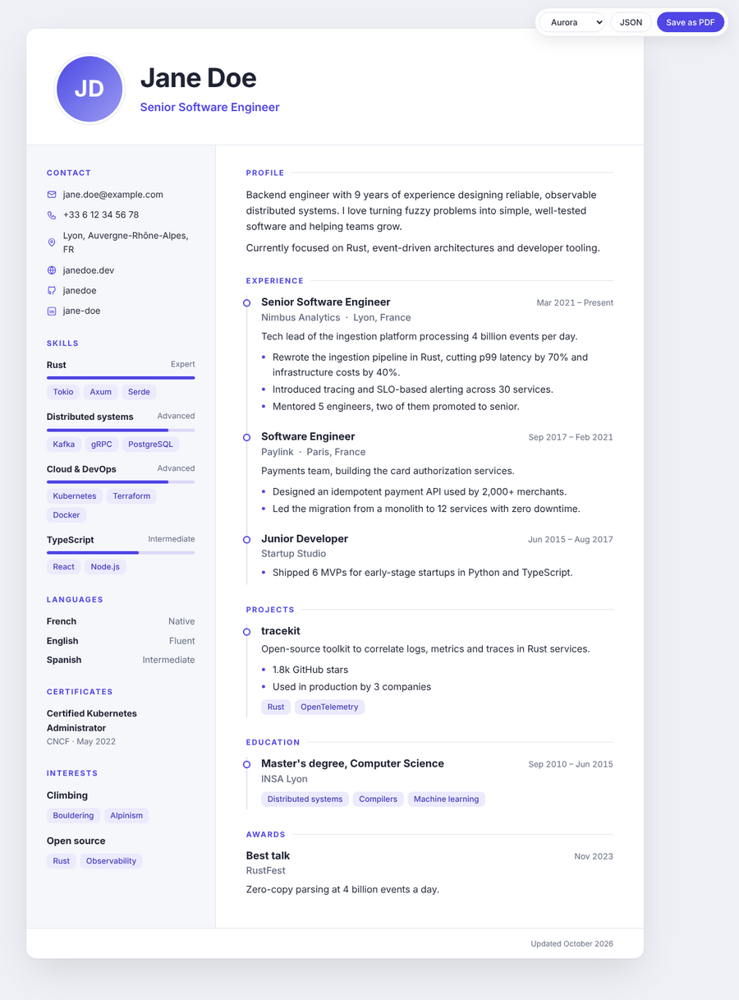
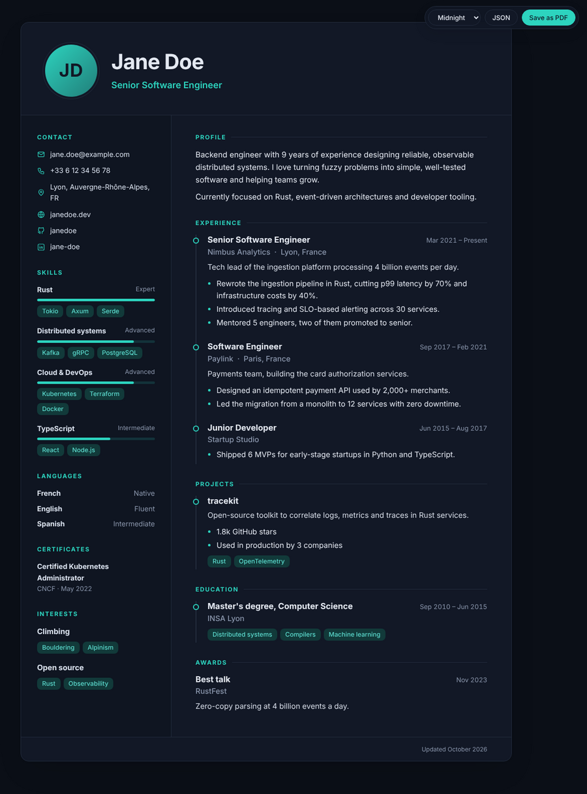
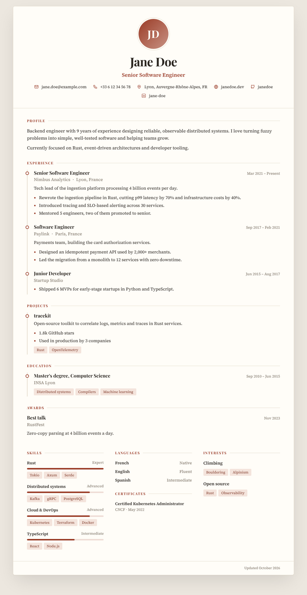
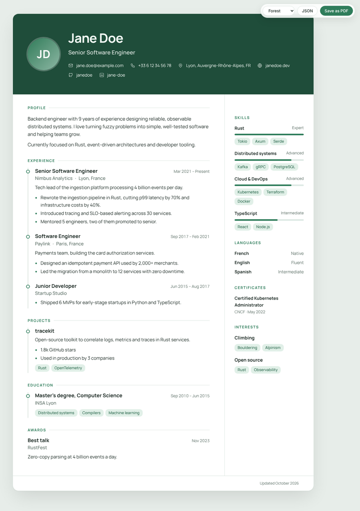
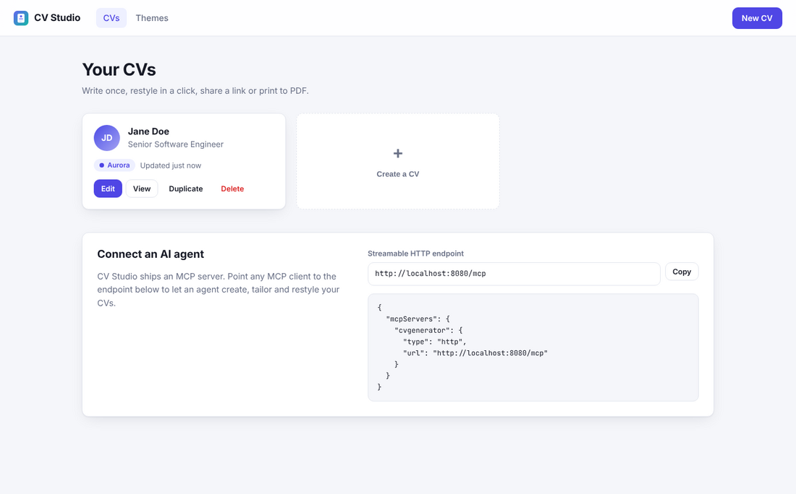
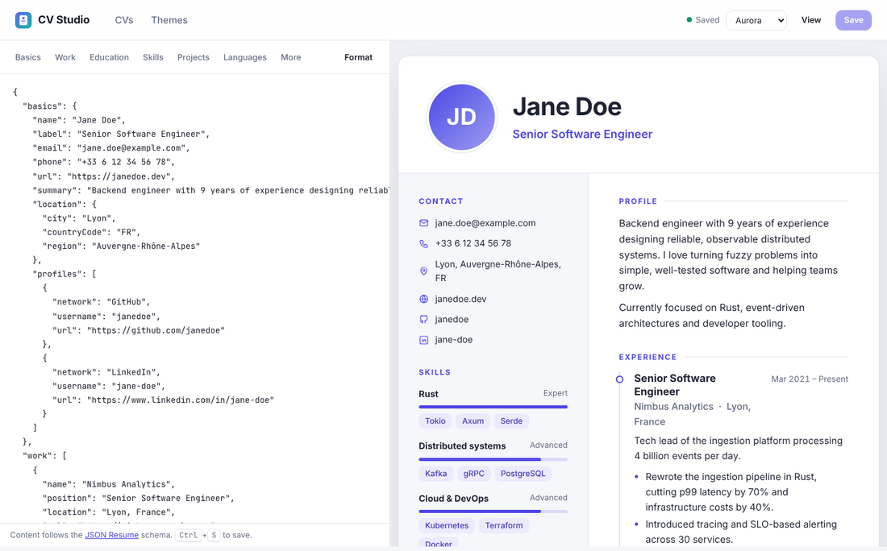
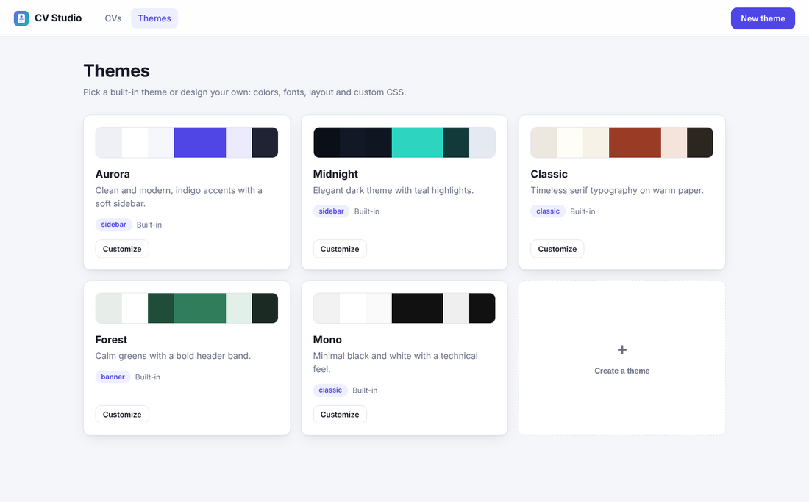

# CV Generator

Self-hosted, themeable curriculum vitae in one small Docker container.
Write your CV once in the [JSON Resume](https://jsonresume.org/schema) format,
restyle it in a click, share a link or print it to PDF. AI agents can manage it
for you through the built-in **MCP server**.



## Features

- **Readable CV pages**: clean typography, responsive layout, print-ready A4 output ("Save as PDF").
- **Themes**: 5 built-in themes (Aurora, Midnight, Classic, Forest, Mono) and 3 layouts (sidebar, classic, banner).
  Create your own with the visual theme editor: colors, fonts, corner radius and custom CSS.
- **Admin UI** (`/admin`): manage several CVs, JSON editor with live preview, theme gallery and editor.
- **REST API** to automate everything.
- **MCP server** (Streamable HTTP at `/mcp`, or stdio) so AI agents (Claude, IDE assistants...) can create,
  tailor and restyle CVs.
- **Rust backend** (Axum + MiniJinja): a single static binary, templates and assets embedded.
- **Plain files storage**: one JSON file per CV and per theme in a volume, easy to back up and version.

| Midnight | Classic | Forest |
| --- | --- | --- |
|  |  |  |

| Dashboard | Editor with live preview | Theme gallery |
| --- | --- | --- |
|  |  |  |

## Quick start

```sh
export CV_API_TOKEN=$(openssl rand -hex 32)   # keep it, you need it to sign in
docker compose up -d --build
```

Open <http://localhost:8080/admin>, sign in with the token, and edit the example CV.
The public page of a CV lives at `http://localhost:8080/cv/<id>`.

Without Compose:

```sh
docker build -t cvgenerator .
docker run -d -p 8080:8080 -v cv-data:/data -e CV_API_TOKEN=change-me cvgenerator
```

## Configuration

Every option is an environment variable (or the matching `--flag`, see `cvgenerator --help`).

| Variable | Default | Description |
| --- | --- | --- |
| `CV_API_TOKEN` | *(unset)* | Token required by the admin UI, REST API and MCP endpoint (`Authorization: Bearer <token>` or `X-Api-Key`). **Set it** whenever the server is reachable by others. Public CV pages never require it. |
| `CV_PUBLIC_URL` | *(unset)* | Public base URL, used to build absolute CV links returned to agents. |
| `CV_HOME` | *(unset)* | Id of the CV served on `/`. When unset, `/` redirects to `/admin`. |
| `CV_BIND` | `0.0.0.0:8080` | Listen address. |
| `CV_DATA_DIR` | `/data` (image), `./data` (binary) | Where CVs and custom themes are stored. |
| `CV_SEED_EXAMPLE` | `true` | Create an example CV when the data directory is empty. |
| `RUST_LOG` | `info` | Log level. |

## Writing a CV

CVs follow the [JSON Resume schema](https://jsonresume.org/schema): `basics`, `work`, `education`, `skills`,
`projects`, `languages`, `volunteer`, `awards`, `certificates`, `publications`, `interests`, `references`.
Every field is optional, and existing JSON Resume files can be imported as-is.

- Dates are ISO 8601 (`2024`, `2024-03` or `2024-03-15`); omit `endDate` for "Present".
- Separate paragraphs with a blank line (`\n\n`) in summaries.
- Skill levels such as `Beginner`, `Intermediate`, `Advanced`, `Expert` (or `75%`) draw a level meter.

See [`examples/jane-doe.json`](examples/jane-doe.json) for a complete example. Any CV can be downloaded as
JSON Resume from its page (`/cv/<id>/resume.json`).

## Themes

A theme is a small JSON document. Only `id` and `name` are required; everything else falls back to defaults.

```json
{
  "id": "sunset",
  "name": "Sunset",
  "description": "Warm orange accents",
  "layout": "banner",
  "colors": {
    "background": "#fdf4ec", "surface": "#ffffff",
    "sidebar": "#7c2d12", "sidebarText": "#fff7ed",
    "text": "#1c1917", "muted": "#78716c",
    "accent": "#ea580c", "accentSoft": "#ffedd5", "border": "#f1e4d8"
  },
  "fonts": {
    "heading": "\"Fraunces\", Georgia, serif",
    "body": "\"Inter\", system-ui, sans-serif",
    "importUrl": "https://fonts.googleapis.com/css2?family=Fraunces:wght@600&family=Inter:wght@400;600&display=swap"
  },
  "radius": "14px",
  "customCss": ".hero h1 { letter-spacing: -0.03em; }"
}
```

- `layout`: `sidebar` (two columns with a tinted sidebar), `classic` (centered single column) or `banner`
  (colored header band).
- Colors, fonts and radius become CSS custom properties (`--accent`, `--font-heading`, ...) used by
  [`static/cv.css`](static/cv.css); `customCss` is appended after it for full control.
- Built-in themes are read-only: use "Customize" in the theme gallery to start a copy.
- Preview any theme on any CV with `?theme=<id>`, e.g. `/cv/jane-doe?theme=midnight`.

## MCP server (AI agents)

The MCP endpoint lets agents list, read, create, edit, duplicate and restyle CVs.

**Streamable HTTP** (remote or local), e.g. with Claude Code:

```sh
claude mcp add --transport http cvgenerator http://localhost:8080/mcp \
  --header "Authorization: Bearer $CV_API_TOKEN"
```

Generic client configuration:

```json
{
  "mcpServers": {
    "cvgenerator": {
      "type": "http",
      "url": "http://localhost:8080/mcp",
      "headers": { "Authorization": "Bearer <CV_API_TOKEN>" }
    }
  }
}
```

**stdio** (for clients that spawn a process, such as Claude Desktop), reusing the running container's data:

```json
{
  "mcpServers": {
    "cvgenerator": { "command": "docker", "args": ["exec", "-i", "<container-name>", "cvgenerator", "mcp"] }
  }
}
```

### Tools

| Tool | Description |
| --- | --- |
| `list_cvs`, `get_cv` | Browse CVs (with their public URL). |
| `create_cv`, `update_cv`, `delete_cv` | Create, replace or delete a CV. |
| `patch_cv` | Apply a JSON Merge Patch (RFC 7396) to the resume. |
| `add_section_item`, `update_section_item`, `remove_section_item`, `move_section_item` | Edit entries of a list section (`work`, `skills`, ...). |
| `duplicate_cv` | Copy a CV, e.g. to tailor it for a job offer. |
| `set_cv_theme` | Change the theme of a CV. |
| `list_themes`, `get_theme`, `save_theme`, `delete_theme` | Manage themes (`save_theme` starts from a base theme, so agents only send what changes). |
| `get_resume_schema` | Documentation of the CV format with a full example. |

The server also exposes every CV as a resource (`cv://<id>`), the format documentation (`cv://schema`), and two
prompts: `tailor_cv` (adapt a copy of a CV to a job description) and `review_cv`.

Example request to an agent: *"Use cvgenerator to duplicate my CV for this job offer, tailor the summary and
highlights to it, switch it to the Classic theme and give me the link."*

## REST API

All `/api` routes accept and return JSON and require the token when `CV_API_TOKEN` is set.

| Method & path | Description |
| --- | --- |
| `GET /api/cvs` | List CVs (summaries). |
| `POST /api/cvs` | Create: `{ "id"?, "theme"?, "resume"? }` (id derived from `basics.name` when omitted). |
| `GET /api/cvs/{id}` | Full document: `{ id, theme, createdAt, updatedAt, resume }`. |
| `PUT /api/cvs/{id}` | Replace: `{ "resume", "theme"? }`. |
| `PATCH /api/cvs/{id}` | `{ "theme"?, "resume"? }` where `resume` is a JSON Merge Patch. |
| `DELETE /api/cvs/{id}` | Delete. |
| `POST /api/cvs/{id}/duplicate` | Copy: `{ "id"? }`. |
| `GET /api/themes`, `POST /api/themes` | List / create themes. |
| `GET` `PUT` `DELETE /api/themes/{id}` | Read, create-or-replace, delete a custom theme. |
| `POST /api/preview` | Render HTML for `{ "resume"?, "theme"?, "themeData"? }` without saving. |

Public routes: `/cv/{id}` (HTML, `?theme=` to preview another theme), `/cv/{id}/resume.json`, `/healthz`.

```sh
curl -X PATCH http://localhost:8080/api/cvs/jane-doe \
  -H "Authorization: Bearer $CV_API_TOKEN" -H "Content-Type: application/json" \
  -d '{"theme": "midnight", "resume": {"basics": {"label": "Staff Engineer"}}}'
```

## Development

```sh
cargo run                       # http://localhost:8080, data in ./data
cargo run -- mcp                # MCP over stdio
cargo test                      # unit and HTTP tests
cargo clippy --all-targets
```

Project layout:

```
src/
  main.rs      CLI entry point (serve | mcp)
  config.rs    configuration (flags and environment variables)
  model.rs     CV document and JSON Resume model, merge patch, slugs
  theme.rs     theme model, validation, built-in themes
  storage.rs   JSON file storage for CVs and themes
  service.rs   shared editing operations (merge patch, section edits)
  render.rs    MiniJinja rendering and template filters
  web.rs       Axum router: pages, REST API, auth
  mcp.rs       MCP server (JSON-RPC core, HTTP and stdio transports)
templates/     CV page and admin UI templates
static/        CSS, admin JavaScript, favicon
```

## License

See [LICENSE](LICENSE).
